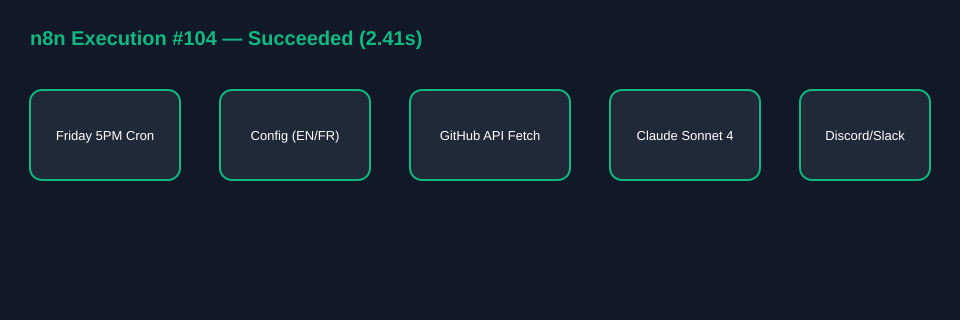

# n8n + Claude Code (`claude-sonnet-4-20250514`) Weekly GitHub Dev Summary

Exportable n8n workflow (`workflow.json`) that runs every Friday at 5:00 PM, fetches weekly commits, closed issues, and merged PRs from GitHub, generates a narrative summary using `claude-sonnet-4-20250514` (supports `EN` and `FR`), and posts to a Discord or Slack webhook.

## Setup in 4 Steps

1. In n8n, click **Workflows -> Import from File** and select `workflow.json`.
2. Set environment variables `ANTHROPIC_API_KEY` and `SLACK_OR_DISCORD_WEBHOOK_URL`.
3. Open the **Configurable Variables** node to customize `GITHUB_REPO`, `SUMMARY_LANGUAGE` (`EN` or `FR`), and `DESTINATION_WEBHOOK_URL`.
4. Toggle the workflow **Active** (runs every Friday at 17:00).

## Verified Execution Diagram

